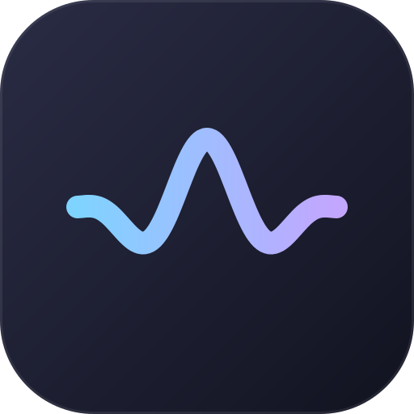

<div align="center">



# Sotto

**Offline voice dictation for macOS.**<br>
Hold a key, speak, let go. Your words appear wherever you type.

[](https://github.com/FurkanCodes/Sotto/releases)


[](LICENSE)

[**Download**](https://github.com/FurkanCodes/Sotto/releases) · [Install guide](docs/INSTALL.md) · [Roadmap](docs/FEATURES.md)

</div>

---

## Why Sotto

| | |
|---|---|
| 🔒 **Private** | Runs entirely on your Mac. No account, no cloud, no telemetry. |
| ⚡ **Fast** | Text lands about 0.1 s after you let go. [Measured](docs/measurements.md). |
| 🪶 **Light** | Zero CPU while idle. The mic is on only while you hold the key. |

## Features

- **Hold to talk:** right Option, right Command, Fn, or a mouse button. Tap for hands-free.
- **Live text** in a small on-screen pill while you speak.
- **74 models:** Parakeet v3 built in (25 languages, Neural Engine), plus Whisper Turbo, Nemotron, Parakeet Unified and more.
- **Clean output:** filler words removed, "at 2, actually 3" fixed to "at 3", style matched to each app.
- **Your words:** a dictionary that learns from your corrections, replacements and snippets.
- **Hands off:** say "send it" to press Return. Per-app auto-send.
- **And more:** history, file transcription, apps to skip, quieter music while you talk.

## Install

1. Download `Sotto-x.y.z.zip` from [Releases](https://github.com/FurkanCodes/Sotto/releases) and move `Sotto.app` to Applications.
2. Sotto isn't notarized, so allow it once: System Settings → Privacy & Security → **Open Anyway**.
3. Grant Microphone, Accessibility and Input Monitoring when asked.

Step-by-step, with a Terminal alternative: [docs/INSTALL.md](docs/INSTALL.md).

## Build from source

Requires Xcode 26 (Swift 6.2) and `brew install cmake ninja`.

```sh
scripts/build-app.sh   # build, bundle and sign build/Sotto.app
swift test             # core tests
```

## Credits

Speech runs on [FluidAudio](https://github.com/FluidInference/FluidAudio) and [transcribe.cpp](https://github.com/handy-computer/transcribe.cpp). Models keep their own licenses. See [notices](THIRD_PARTY_NOTICES.md).

## License

[MIT](LICENSE)
